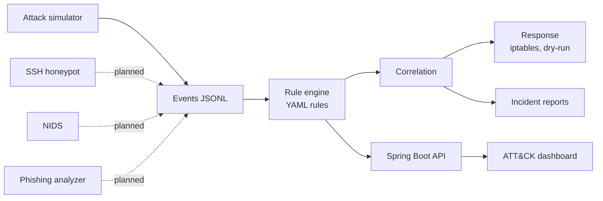
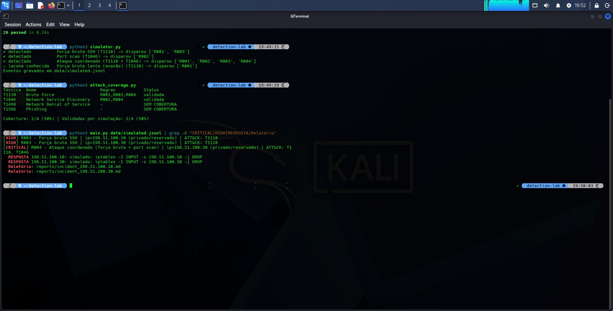

# Detection Engineering Lab

A small detection engineering platform built from scratch in Python, with a Java Spring Boot dashboard.
It covers the full cycle: **simulate an attack → detect → classify (MITRE ATT&CK) → respond → report → measure coverage**.

## Architecture



## Features

- **Rule engine**: Sigma-style YAML rules with simple matches, thresholds with time windows, and correlation across sources.
- **MITRE ATT&CK mapping**: every rule points to a technique and a tactic.
- **IP enrichment**: country and ISP lookup, optional AbuseIPDB reputation, local cache.
- **Automated response**: IP blocking with iptables. Dry-run by default, allowlist, severity gate and audit log.
- **Incident reports**: one Markdown report per incident, with a timeline.
- **Attack simulator**: synthetic attack scenarios that test the rules (adversary emulation).
- **Coverage metric**: which target techniques have a rule, and which were validated by a simulation.
- **SIEM integration**: sends alerts and coverage to a Spring Boot API (API key, validation, duplicate protection). The dashboard shows an ATT&CK coverage map.

## Quick start

With Docker (safe demo, no firewall changes):

```bash
docker build -t detection-lab .
docker run --rm detection-lab
```

Local:

```bash
python3 -m venv venv && source venv/bin/activate
pip install -r requirements.txt
python3 -m pytest -v
python3 simulator.py
python3 main.py data/simulated.jsonl
python3 attack_coverage.py
```

## Example rule

```yaml
id: R003
name: SSH brute force
severity: high
match:
  source: honeypot
  event_type: ssh_login_failed
threshold:
  count: 5
  window_seconds: 120
  group_by: src_ip
mitre:
  - tactic: Credential Access
    id: T1110
    name: Brute Force
```

## Simulation results

| Scenario | Technique | Result |
|---|---|---|
| SSH brute force | T1110 | detected |
| Port scan | T1046 | detected |
| Coordinated attack (brute force + scan) | T1110 + T1046 | detected by correlation |
| Slow brute force (evasion) | T1110 | **not detected** (known gap) |

## Known limitations

- A slow brute force (5 failures in 280 s) evades rule R003 (120 s window). The simulator documents it as a known gap.
- ATT&CK coverage is 2 of 4 target techniques. T1498 and T1566 have no rules yet.
- Events are synthetic. The honeypot, NIDS and phishing analyzer do not emit this event format yet.
- On the SIEM side, coverage is kept in memory and the read endpoints have no login yet.
- Automatic blocking can cause false positives. This is why dry-run is the default.

## Safety

Use `--apply` only on machines you own. Add your own IP to `data/allowlist.txt` first.

## Tests

`python3 -m pytest -v` runs 26 tests (rules, correlation, enrichment, response, reports, simulator, coverage, SIEM client).

## Attacker profile card



Shows location, ISP/ASN, datacenter/proxy flags, the attacker's local time next to yours, duration, ATT&CK techniques and severity. The IP is masked by default and the geolocation in this demo is simulated. IP geolocation is approximate and does not identify a person.

